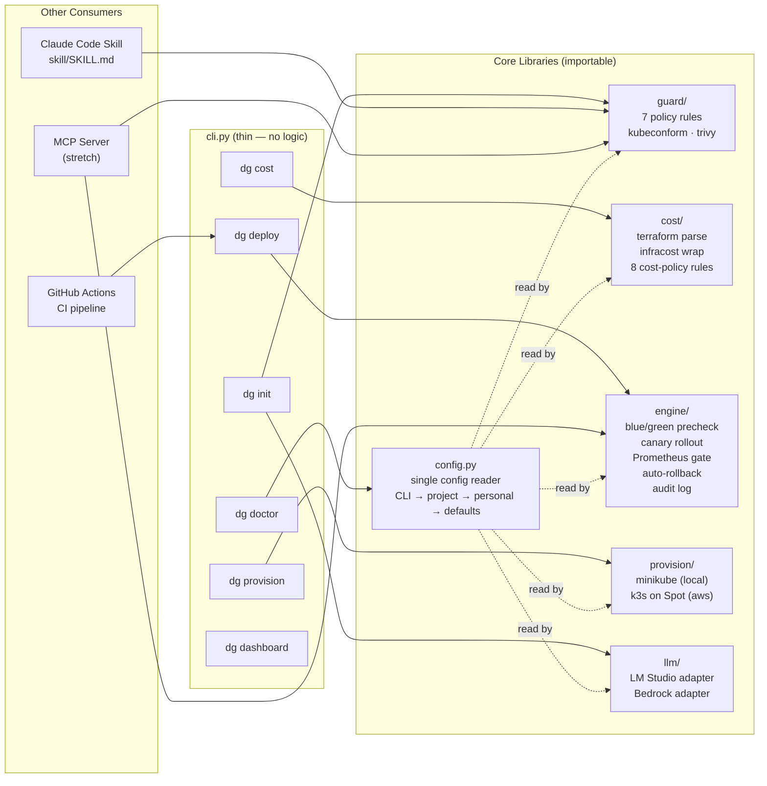
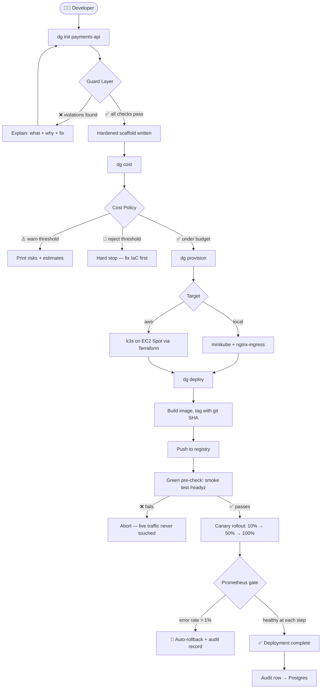
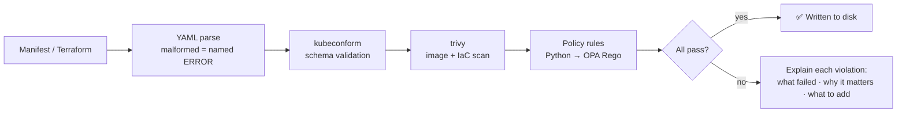

# 🛡️ DeployGuard

**From `git init` to safely-deployed Kubernetes service in four commands.**

*Scaffolds hardened configs · Validates its own output · Guards your cloud bill · Deploys with automatic rollback*

[](https://www.python.org/downloads/)
[](LICENSE)
[](https://github.com/toni7891/DeployGuard/actions/workflows/ci.yaml)
[](https://pypi.org/project/dg-deploy/)
[](https://typer.tiangolo.com/)
[](https://k3s.io/)
[](#cost-model)

---

```
dg init payments-api
dg cost
dg provision
dg deploy
```

*Four commands. No flags to remember. Team config in a committed file.*

---

## Installation

### Option A — Homebrew tap (macOS, recommended)

```bash
brew tap toni7891/deployguard
brew trust toni7891/deployguard
brew install deployguard
```

> **macOS 27:** `brew trust` is required (new tap trust model). One-time step per tap. Any "Tier 2 configuration" warning is about macOS 27 being pre-release — safe to ignore.

Homebrew installs kubectl, helm, minikube, kubeconform, infracost, and `dg` automatically. Then add two third-party taps:

```bash
brew tap hashicorp/tap && brew install hashicorp/tap/terraform
brew tap aquasecurity/trivy && brew install aquasecurity/trivy/trivy
```

---

### Option B — One-liner (macOS + Linux)

```bash
curl -fsSL https://raw.githubusercontent.com/toni7891/deployguard/main/scripts/install.sh | bash
```

Detects your OS, installs all prerequisites, and installs `dg` via `pipx`. Pin a version:

```bash
DEPLOYGUARD_VERSION=0.1.0 curl -fsSL https://raw.githubusercontent.com/toni7891/deployguard/main/scripts/install.sh | bash
```

---

### Option C — Manual

```bash
# Kubernetes toolchain
brew install kubectl helm minikube

# Validation
brew install kubeconform
brew install aquasecurity/trivy/trivy

# Infrastructure + cost
brew tap hashicorp/tap && brew install hashicorp/tap/terraform
brew install infracost

# DeployGuard
pipx install dg-deploy          # recommended — isolated
# or from source: pip install -e ".[dev]"
```

For Docker: [Docker Desktop](https://docs.docker.com/get-docker/) or `brew install --cask docker`. On Linux, `dg doctor` shows exact install commands for each missing tool.

---

### Verify your setup

```bash
dg doctor
```

`dg doctor` checks every prerequisite and validates config files. Fix anything marked `✗` before continuing.

```
Prerequisites
 ✓  Python >= 3.11   Python 3.12.3
 ✓  docker           Docker version 26.1.1
 ✓  kubectl          Client Version: v1.30.0
 ✓  helm             v3.15.0
 ✓  minikube         minikube version: v1.33.0
 ✓  kubeconform      Version: 0.6.7
 ✓  trivy            Version: 0.51.1
 ✓  terraform        Terraform v1.8.4
 ✓  infracost        Infracost v0.10.39

Config files
 ✓  project config   .deployguard/config.yaml  valid
 –  personal config  ~/.deployguard/config.yaml not found (using defaults)

✅ All prerequisites met.
```

---

## Why DeployGuard

Deploying a new service to Kubernetes from scratch means writing a Dockerfile, manifests, a CI pipeline, and infrastructure — each a place to get something subtly wrong:

- No resource limits → one pod starves a node and takes its neighbours down
- No readiness probes → broken pods receive live traffic
- `:latest` image tag → silent rollback to stale code
- IAM wildcard → blast radius of a compromised key is your whole account
- NAT Gateway added "temporarily" → +$32/mo forever

DeployGuard is an opinionated **paved road**: one command scaffolds a known-good stack with hardened configs, one checks what it'll cost before you spend a dollar, one provisions the cluster, and one deploys with a gradual traffic shift that **rolls back automatically if error rates spike**. It validates its own output — the generator is never trusted blindly.

> **The meta story:** DeployGuard deploys itself, the same way it deploys everything else.

---

## 5-Minute Local Demo

No cloud account required. Runs entirely on your machine.

```bash
# 1. Scaffold a new service (validates output before writing)
dg init payments-api
cd payments-api

# 2. Check what it'll cost (optional but recommended)
dg cost

# 3. Bring up a local Kubernetes cluster (minikube + ingress + Prometheus)
dg provision

# 4. Build, deploy, and watch the canary rollout
dg deploy
```

These four commands are all you need locally. `dg provision` also enables ingress-nginx request metrics and installs a small Prometheus in the `monitoring` namespace, and `dg deploy` port-forwards to it and sends light test traffic through the ingress during the canary steps, so the automatic rollback gate has real error-rate data with no extra setup. No manual `kubectl port-forward`, Prometheus install or request loop needed.

App is live. To open the Kubernetes dashboard:

```bash
dg dashboard
```

The generated service runs in the `deployguard` namespace with `/healthz` + `/readyz` probes, resource limits, a non-root securityContext (UID/GID 10001), and a pinned image tag. The guard reports zero errors and zero warnings on the generated manifests.

---

## Command Reference

### `dg doctor`

Checks all required binaries, Python version, Docker daemon, and config files. No flags. Run first on any new machine.

---

### `dg init`

Scaffold a hardened FastAPI+Postgres service, then validate the output before writing it.

```bash
dg init payments-api
dg init payments-api --no-guard   # skip guard (throwaway spike only — never in CI)
```

**Emits:**

```
payments-api/
├── Dockerfile               # pinned python:3.11-slim base, non-root user (UID/GID 10001)
├── app/
│   ├── main.py              # FastAPI app with /healthz and /readyz
│   └── requirements.txt
├── k8s/
│   ├── deployment.yaml      # probes, resource limits, securityContext, non-root
│   ├── service.yaml         # ClusterIP, selects track: stable pods only
│   ├── serviceaccount.yaml  # automountServiceAccountToken: false
│   └── ingress.yaml         # stable nginx Ingress (host <name>.local); required for canary weights
└── deployguard.yaml         # per-service manifest (name, port, health endpoints, namespace, host)
```

The guard layer runs on the generated output — if `dg init` produces a manifest that violates policy, it fails loudly and tells you why before writing anything to disk.

---

### `dg cost`

Static cost report on your generated `infra/` before a single dollar is spent.

```bash
dg cost               # run from your service directory
dg cost infra/        # explicit path
dg cost --explain     # verbose reasoning per finding
```

Three sections:
1. **What will spin up** — parsed from `terraform show -json` and k8s manifests
2. **Estimated monthly cost** — running and paused figures from Infracost
3. **Bill-inflation risks** — cost-policy rules that editorialize about footguns

```
📦 Resources that will spin up
  aws_instance.k3s_server     t3.small  (Spot)
  aws_db_instance.postgres    db.t3.micro
  aws_route53_record.api      (DNS only)
  kubernetes pods             2 × payments-api

💰 Estimated monthly cost
  Running:  $6.25/mo
  Paused:   $3.55/mo  (compute stopped, storage + DNS only)

⚠️  Cost policy warnings
  WARN  iam_least_privilege: IAM role uses Action: "*" — blast radius is your
        entire account. Scope to the minimum required actions.

✅ Under warn threshold ($10.00). Looks good.
```

Thresholds (`warn_threshold`, `reject_threshold`) live in team config — not flags.

---

### `dg provision`

Bring up a Kubernetes cluster. Idempotent — safe to re-run.

```bash
dg provision                  # uses target from .deployguard/config.yaml
dg provision --target local   # bring up minikube
dg provision --target aws     # spin up k3s on EC2 Spot via Terraform
```

**Local:** starts minikube, enables the ingress addon, creates the `deployguard` namespace, enables ingress-nginx request metrics (`--enable-metrics=true` on the controller), and installs a small Prometheus (`prom/prometheus:v2.55.1`, namespace `monitoring`, scrapes the ingress controller every 5s, 1h retention) for the rollback gate. Every step is idempotent. No cloud account needed. If you restart minikube outside DeployGuard, re-run `dg provision` to make sure the metrics flag is still set.

**AWS:** runs Terraform in `infra/` to provision k3s on EC2 Spot — public subnet, no NAT Gateway, Elastic IP. Run `dg cost` first.

---

### `dg deploy`

Build → push → safe rollout with health checks and automatic rollback.

```bash
dg deploy
dg deploy --target local
dg deploy --target aws
```

**What happens:**
1. Build image, tag with git SHA
2. Push to ECR (aws) or load into minikube (local)
3. Apply green deployment, wait for pods ready (live Rich panel)
4. Smoke test `/readyz` — abort before touching live traffic if it fails
5. Canary rollout: 10% → 50% → 100% via nginx-ingress canary weights (10s per step)
6. Query Prometheus for the canary backend's 5xx rate at each step (no data / Prometheus unreachable = gate inactive, never blocks)
   - **Local:** `dg deploy` port-forwards to the Prometheus that `dg provision` installed and, while the canary steps run, sends about 10 test requests/second to your service's host through the ingress (`traffic: sending test requests to <host> (local target)`). The test traffic stops before promotion or rollback, and both port-forwards are always closed when `dg deploy` finishes, even on failure. Turn the test traffic off with `deploy.smoke_traffic: false`.
   - **AWS:** no Prometheus is installed and no test traffic is sent; point `deploy.prometheus_url` at your own Prometheus to enable the gate.
7. If it exceeds the threshold (default 1%): delete the canary Deployment/Service/Ingress (all traffic back on the untouched stable) and stop
8. Write audit row (who/what/when/result) to Postgres

```
● Deploying payments-api (sha: a1b2c3d)

  Pre-check
  ┌─────────────────────────────────────────────┐
  │  STABLE  2/2   GREEN  2/2   /readyz  ✓     │
  └─────────────────────────────────────────────┘

  Canary rollout
  ░░░░░░░░░░░░░░░░░░░░░  10% — error rate: 0.0% ✓
  ░░░░░░░░░░░░░░░░░░░░░  50% — error rate: 0.1% ✓
  ████████████████████  100% — error rate: 0.0% ✓

✅ Deployed. payments-api @ a1b2c3d
```

---

### `dg dashboard`

```bash
dg dashboard          # open browser
dg dashboard --url    # print URL only (useful in SSH sessions)
```

---

## Configuration

### Team config (`.deployguard/config.yaml`)

Commit this. Every teammate runs the same four commands and gets identical behavior.

```yaml
guard:
  strict: true
  explain: true
  rules:
    require_resource_limits: error
    require_probes:          error
    require_security_context: error
    no_latest_tag:           error
    no_root_user:            error
    no_privileged_containers: error
    iam_least_privilege:     warn
  custom_rules_dir: .deployguard/rules/

cost:
  currency: USD
  warn_threshold:   10.00
  reject_threshold: 50.00
  always_explain: false

deploy:
  target: local
  error_rate_threshold: 1.0
  rollout_steps: [10, 50, 100]
  smoke_timeout: 60
  audit: true
  # prometheus_url: http://prom:9090   # unset = local: managed port-forward to the Prometheus
  #                                    # `dg provision` installs; aws: http://localhost:9090.
  #                                    # Unreachable = gate inactive (never blocks).
  smoke_traffic: true                  # local only: test traffic during canary steps
```

All fields optional — built-in defaults cover a solo dev with no config file.

### Personal config (`~/.deployguard/config.yaml`)

Never commit this. Machine-specific settings only.

```yaml
llm:
  backend: local              # local (LM Studio) | bedrock (AWS)
  model: qwen2.5-coder:14b
  temperature: 0.2
```

### Service manifest (`deployguard.yaml`)

Generated by `dg init`. Describes this specific service — not the tool config.

```yaml
name: payments-api
port: 8080
replicas: 2
health_liveness:  /healthz
health_readiness: /readyz
namespace: deployguard
host: payments-api.local   # optional; Ingress host, defaults to <name>.local
```

### Config priority order

```
CLI flag  →  project config  →  personal config  →  built-in defaults
```

Flags are escape hatches. Behavior that applies to a team goes in `.deployguard/config.yaml`.

### Custom policy rules

Drop `.py` files into `.deployguard/rules/` — auto-loaded, no code change required.

```python
# .deployguard/rules/require_team_label.py

def check(manifest: dict) -> list[dict]:
    labels = manifest.get("metadata", {}).get("labels", {})
    if "team" not in labels:
        return [{
            "rule": "require_team_label",
            "severity": "error",
            "message": "Missing required label 'team'.",
            "explanation": (
                "The 'team' label is required for ownership tracking and alert routing. "
                "Add metadata.labels.team: <your-team-name> to this manifest."
            ),
        }]
    return []
```

---

## Cluster Cost Controls

```bash
make up       # init + apply (bring cluster to running state)
make pause    # stop EC2 instance; keep EIP + DNS   (~$3.55/mo while paused)
make resume   # recreate instance and reattach EIP
make destroy  # tear down all AWS resources
```

---

## AWS Deployment

Set `deploy.target: aws` in `.deployguard/config.yaml`, then the same four commands work unchanged.

```bash
export AWS_ACCESS_KEY_ID=...
export AWS_SECRET_ACCESS_KEY=...
export AWS_DEFAULT_REGION=us-east-1

dg doctor
dg cost                   # review before spending anything
dg init payments-api
dg provision              # spins up k3s on EC2 Spot — billable from here
dg deploy
```

Running cost: ~$6.25/mo (EC2 Spot + RDS micro + Route 53, no NAT Gateway).

---

## Standalone Claude Code Skill

The guard layer ships as a standalone Claude Code skill — no cluster, no AWS, no `dg` install.

```bash
mkdir -p .claude/skills/deployguard-guard
cp /path/to/deployguard/skill/SKILL.md .claude/skills/deployguard-guard/SKILL.md
```

```
/guard k8s/deployment.yaml
/guard infra/main.tf
/guard k8s/
```

Runs kubeconform schema validation, trivy image scan, and all 7 policy rules. Each violation explains what failed, why it matters, and exactly what to add. Primary use case: paste an LLM-generated manifest and get a senior reviewer's assessment.

---

## Architecture



`guard/`, `cost/`, and `engine/` are libraries, not scripts. The CLI, the Claude Code skill, and a future MCP server all import the same modules. Core logic never lives inside CLI handlers.

---

## How It Works



---

## Guard Layer



| Rule | Severity | Why it matters |
|---|---|---|
| `require_resource_limits` | error | One pod can starve a node and take neighbors down |
| `require_probes` | error | Broken pods receive live traffic without readiness probes |
| `require_security_context` | error | Missing non-root + read-only root filesystem |
| `no_latest_tag` | error | Silent rollback to stale code on node restart |
| `no_root_user` | error | Container escape → host root |
| `no_privileged_containers` | error | Privileged = host kernel access |
| `iam_least_privilege` | warn | IAM wildcard = full account blast radius |

Every violation explains itself:

```
✗ require_resource_limits
  Without resource limits, one misbehaving pod can consume all CPU and memory
  on its node, causing an OOM kill cascade that takes other services down with it.
  Add resources.requests and resources.limits to every container spec.
```

---

## Cost Model

| Rule / State | Default | Notes |
|---|---|---|
| NAT Gateway present | reject | +$32/mo + data processing fees |
| On-demand instead of Spot | warn | 3–5× cost premium |
| Oversized instance | warn | Relative to golden-path baseline |
| Load balancer (ALB/NLB) | warn | +$16+/mo each |
| Uncapped RDS autoscaling | warn | Silent bill inflation |
| Standing resource, no pause path | reject | Must have `make pause` or `make destroy` |
| **Running** | ~$6.25/mo | EC2 Spot + RDS micro + Route 53; no NAT Gateway |
| **Paused** | ~$3.55/mo | Compute stopped; storage + DNS only |
| **Local** | $0 | minikube on your machine |

---

## Tech Stack

| Concern | Choice |
|---|---|
| CLI | Python + Typer |
| Config / schemas | Pydantic |
| Terminal UX | Rich (live rollout panel) |
| Templating | Jinja2 |
| Manifest validation | kubeconform + trivy + Python policy rules |
| Cost estimation | Infracost JSON + `terraform show -json` |
| Deploy engine | Python module + `kubernetes` client |
| Metrics | Prometheus HTTP API (PromQL) |
| Audit | SQLAlchemy → Postgres |
| Local cluster | minikube + ingress addon |
| Prod cluster | k3s on EC2 Spot, no NAT Gateway |
| Registry | ECR |
| CI/CD | GitHub Actions |
| LLM (stretch) | LM Studio (local) or AWS Bedrock |

---

## Testing

```bash
pip install -e ".[dev]"

pytest                              # full suite
pytest tests/test_guard.py          # guard + policy unit tests
pytest tests/test_smoke_e2e.py      # spine test — must always pass
pytest tests/test_cost.py           # cost policy rules
pytest tests/test_config.py         # config priority order + schema validation
pytest -m "not integration"         # skip tests that require a running cluster
```

`test_smoke_e2e.py` is the branch-protection gate. No merge breaks the spine.

---

## Project Structure

```
deployguard/
├── cli.py               # Typer entrypoint — thin; no logic lives here
├── config.py            # single config reader — every module reads through this
├── guard/               # kubeconform + trivy + 7 policy rules with explanations
├── cost/                # terraform parse + infracost + 8 cost-policy rules
├── engine/              # blue/green precheck · canary rollout · rollback · audit
├── provision/           # minikube (local) and k3s on Spot (aws)
├── llm/                 # thin adapter: LM Studio local or AWS Bedrock
└── scaffold/            # Jinja2 templates for the golden path
skill/
└── SKILL.md             # standalone Claude skill — wraps guard/
infra/                   # Terraform: k3s on EC2 Spot (no NAT Gateway)
tests/
├── test_guard.py
├── test_cost.py
├── test_config.py
└── test_smoke_e2e.py    # spine test — must always pass
```

---

## Contributing

1. Lock contracts first — `deployguard.yaml` Pydantic schema, config schema, `dg init` output shape.
2. `test_smoke_e2e.py` is the branch-protection gate — never merge red.
3. Core logic stays in libraries (`guard/`, `cost/`, `engine/`) — not in CLI handlers.
4. Conventional commits, one vertical slice per PR, cross-lane review.
5. Flags are escape hatches — if it can live in config, it goes in config.

---

## Milestone Status

| Milestone | Status | Description |
|---|---|---|
| M-1 Guard skill | ✅ Done | Standalone module + SKILL.md |
| M0 Spine | ✅ Done | init → provision → deploy end-to-end |
| M1 Harden + cost | ✅ Done | Hardened templates, guard in init, dg cost, full config |
| M2 Deploy engine | ✅ Done | Gradual rollout, Prometheus gate, auto-rollback, audit |
| M3 AWS + self-deploy | ✅ Done | ECR, k3s on Spot, GitHub Actions CI, self-deploy |
| M4 LLM + MCP | 🚧 In progress | LM Studio adapter working; Bedrock + MCP server pending |

---

## License

MIT

---

**DeployGuard deploys itself — the same way it deploys everything else.**

[Quick Start](#5-minute-local-demo) · [Command Reference](#command-reference) · [Skill](skill/SKILL.md) · [PRD](PRD.md) · [Issues](../../issues)
